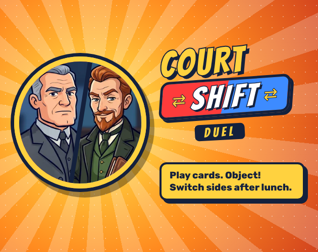

# Court Shift: Duel ⚖️⇄

**A courtroom card duel where you might switch sides after lunch.**
Made for **GitHub Game Off 2026** (theme: **SHIFT**) by [Bridgeman Entertainment](https://bridgemanentertainment.itch.io/).

▶ **Play:** https://bridgemanentertainment.itch.io/court-shift
▶ **Play on GitHub Pages:** https://bridgemanentertainmentproductions.github.io/court-shift/



## The game

One case. Three lanes. Hidden moves. You argue a real-feeling Swedish criminal trial against the computer, card by card.

* **Three lanes = three elements of the crime** (the act, the person, the intent). The prosecution must win **all three**. The defense only needs **one**.
* **Court time.** Round 1 gives you 1 minute, round 2 two minutes and so on. Cards cost minutes.
* **Hidden moves.** Both sides play in secret, press DONE, and everything is revealed at once.
* **Mini-puzzles on every card.** Spot the contradiction, sort the timeline, find the fake, work out the alibi time and more. Solve it for full strength.
* **Objection!** Strike the other side's new card, unless they answer with a **Rebuttal!**
* **Turn the tables** steals the strongest card in a lane.
* **The SHIFT:** after the lunch break you may have to switch sides and finish the trial defending the case you just built.
* Arthur C. Bara, the capybara detective, can testify, but only for one side.

Plays in **English or Swedish** (picks your device language), on phones, tablets and PC.
On PC and tablets the screen becomes a full courtroom: judge, lay judges and clerk on the bench, prosecutor to the left, defense counsel and defendant to the right.

## How the theme is used

*Shift* is the core rule: the trial can shift sides at lunch, cards shift sides with *Turn the tables*, and a lane can shift with every objection.

## Build

The game ships as one self-contained `index.html` (no server, no dependencies).

```
python3 build.py      # builds index.html from src/, shared/ and assets/
node src/sim.js       # balance simulation: 3000 AI-vs-AI trials
```

| Folder | Contents |
|---|---|
| `src/game.html` | UI, puzzles, tutorial, courtroom layout |
| `src/engine.js` | Rules engine (no DOM): lanes, cards, reveal, objections, AI |
| `src/cases.js` | The three cases and their evidence |
| `src/notes.js` | Short notes on Swedish criminal procedure |
| `shared/` | Fonts, splash and audio shared with *Arthur C. Bara's Marvelous Mysteries* |
| `assets/` | Portraits and card art |

## AI disclosure

Court Shift is a solo indie project by Bridgeman Entertainment, made with the help of generative AI. The game design, ideas, cases, legal framing and direction are my own. AI helped write the code and texts and composed the music and sound effects as code. Character portraits and card art were created with an AI image tool from my own descriptions, then picked and edited by me.

## Licence

* **Code** (`src/`, `build.py`, `shared/audio.js`): MIT, see [LICENSE](LICENSE).
* **Art, characters and case texts** (`assets/`, `src/cases.js`, `src/notes.js`): © 2026 Bridgeman Entertainment, all rights reserved. You may view and play them as part of this repository.
* Fonts: Bangers and Rubik, SIL Open Font License 1.1.

---

### På svenska

Ett kortspel i rättssalen byggt på svensk straffprocess. Åklagaren måste bevisa alla tre rekvisit, försvaret räcker att vinna ett. Efter lunch kan ni få byta sida. Gjort för GitHub Game Off 2026 av Bridgeman Entertainment.
